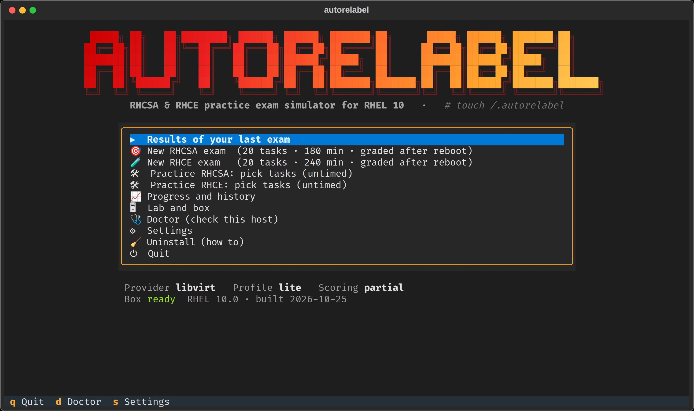
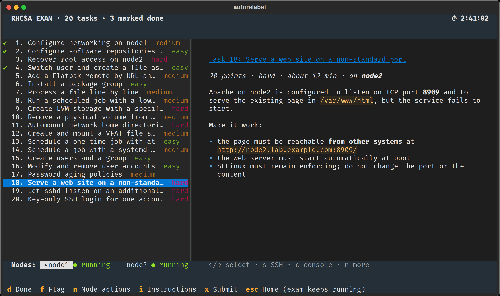
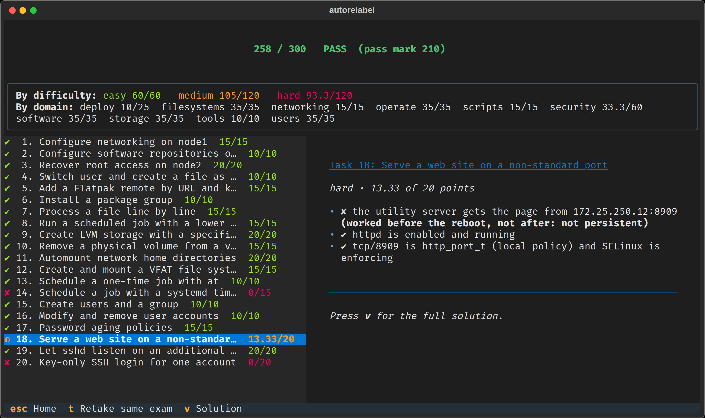

<div align="center">


# autorelabel: RHCSA & RHCE practice exam simulator for RHEL 10

**Timed, auto-graded, hands-on RHCSA (EX200) and RHCE (EX294) practice exams on real RHEL 10 virtual machines, graded *after a reboot*, just like the real thing.**

`touch /.autorelabel`: forget it after `rd.break` and your node won't let you log in. You'll never forget again.

</div>

---

## What it is

`autorelabel` builds a small RHEL 10 lab on your Linux machine (with libvirt/KVM or VirtualBox), gives you a **20-task RHCSA exam** (180 minutes) or **RHCE exam** (240 minutes), then **reboots every node and grades your work out of 300** (pass mark 210), the way Red Hat's performance-based exams do.

- **Real RHEL 10**: a Vagrant box built *once* from **your own** RHEL 10 DVD ISO (free Red Hat Developer account). No subscription is used anywhere; the lab is fully offline like the exam.
- **Exam-like start**: one node has no network yet (configure it from the console), the other node's root password is unknown (interrupt the boot and reset it), and repositories must be configured. That's how most real RHCSA exams begin. An RHCE exam starts from an empty project directory: write the inventory and `ansible.cfg`, set up the `ansible` user's SSH key and sudo on the managed nodes, install the collections and configure the repositories, all with Ansible.
- **Graded after a reboot**: every node is rebooted before grading, so only persistent configuration counts. Work that *"passed before the reboot but not after"* is flagged so you learn exactly what wasn't persistent.
- **Honest, method-agnostic grading**: checks look at the final state (UUID *or* LABEL, `nmcli` *or* keyfiles, `parted` *or* `fdisk`…), never at the commands you typed.
- **Every task self-tested on real VMs**: setup, reference solution, accepted alternatives and the classic mistakes (`chcon` instead of `semanage fcontext`, firewall rules without `--permanent`, `setenforce` without the config file, a vault file left unencrypted, a role default put in `vars/`…) are all verified on a real RHEL 10 VM before a task ships.
- **Full objective coverage**: the bank maps every task to Red Hat's **current, verbatim objectives**, with at least two tasks per objective line; see [docs/COVERAGE-RHCSA.md](docs/COVERAGE-RHCSA.md) and [docs/COVERAGE-RHCE.md](docs/COVERAGE-RHCE.md).
- **Difficulty levels**: every task is *easy* (10 pts), *medium* (15) or *hard* (20) by a written rubric; each exam has the same mix, so scores are comparable.
- **One command, a friendly TUI**: setup wizard, live countdown, node power controls, serial console, results with explanations and official-docs references.
- **Leaves your host clean**: one command removes everything it created.

> Not affiliated with or endorsed by Red Hat. Built only from Red Hat's public exam objectives and documentation. Contains **no** real exam content. RHCSA, RHCE and RHEL are trademarks of Red Hat, Inc.

## Supported hosts

| Host | Status |
|---|---|
| **Linux x86_64** (Ubuntu/Debian, Fedora, RHEL/Alma/Rocky/CentOS Stream, Arch, openSUSE) | ✅ libvirt/KVM (recommended) or VirtualBox 7.2.2+ |
| Windows 10/11 | ❌ **Not supported yet**: planned for v2 (VirtualBox) |
| WSL2 | ❌ Not supported |
| macOS | ❌ Not supported |

## Requirements

**Hardware:** an x86-64-v3 CPU (Intel Haswell / AMD Excavator or newer; RHEL 10 requires it) with virtualization enabled in the BIOS/UEFI, **about 3 GB of free RAM** (RHCSA, *lite* profile; about 5.5 GB for RHCE) and **about 30 GB of free disk** (40 GB for RHCE).

**Software:** install these before you clone. autorelabel never runs `sudo` itself: on its first run it checks your host again and prints the exact commands (with undo commands) for anything still missing.

| What | Why |
|---|---|
| `git`, Python 3.10+ with `venv`, the OpenSSH client | to clone and run autorelabel (its Python libraries go into a private `.venv/`) |
| Vagrant 2.3+ and Packer 1.10+ | Packer builds the RHEL 10 box from your ISO once; Vagrant runs the lab VMs |
| **libvirt** (recommended): QEMU/KVM, libvirt and the `vagrant-libvirt` plugin, with your user in the `libvirt` and `kvm` groups | the hypervisor |
| **or VirtualBox** 7.2.2+, with your user in the `vboxusers` group | the hypervisor, instead of libvirt |

The commands for libvirt on each distribution (log out and back in afterwards, so the new groups apply):

<details>
<summary><b>Ubuntu / Debian</b></summary>

```bash
sudo apt update
sudo apt install -y git python3-venv openssh-client wget gpg qemu-system-x86 qemu-utils libvirt-daemon-system libvirt-clients
# Vagrant and Packer, from HashiCorp's repository
wget -O - https://apt.releases.hashicorp.com/gpg | sudo gpg --dearmor -o /usr/share/keyrings/hashicorp-archive-keyring.gpg
echo "deb [arch=$(dpkg --print-architecture) signed-by=/usr/share/keyrings/hashicorp-archive-keyring.gpg] https://apt.releases.hashicorp.com $(grep -oP '(?<=UBUNTU_CODENAME=).*' /etc/os-release || lsb_release -cs) main" | sudo tee /etc/apt/sources.list.d/hashicorp.list
sudo apt update && sudo apt install -y vagrant packer
# the vagrant-libvirt plugin
sudo apt install -y libvirt-dev build-essential pkg-config ruby-dev libxml2-dev libxslt1-dev zlib1g-dev
vagrant plugin install vagrant-libvirt
sudo systemctl enable --now libvirtd
sudo usermod -aG libvirt,kvm $USER
```

</details>

<details>
<summary><b>Fedora</b></summary>

```bash
sudo dnf install -y git python3 openssh-clients wget @virtualization vagrant vagrant-libvirt
sudo systemctl enable --now virtqemud.socket virtnetworkd.socket virtstoraged.socket
# Packer, from HashiCorp's repository (Fedora's own Vagrant stays: its vagrant-libvirt is built for it)
wget -O- https://rpm.releases.hashicorp.com/fedora/hashicorp.repo | sudo tee /etc/yum.repos.d/hashicorp.repo
sudo sed -i '/^\[hashicorp\]/a excludepkgs=vagrant' /etc/yum.repos.d/hashicorp.repo
sudo dnf install -y packer
sudo usermod -aG libvirt,kvm $USER
```

</details>

<details>
<summary><b>RHEL / AlmaLinux / Rocky Linux / CentOS Stream</b></summary>

```bash
sudo dnf install -y git python3 openssh-clients dnf-plugins-core qemu-kvm libvirt virt-install
sudo systemctl enable --now virtqemud.socket virtnetworkd.socket virtstoraged.socket
# Vagrant and Packer, from HashiCorp's repository
sudo dnf config-manager --add-repo https://rpm.releases.hashicorp.com/RHEL/hashicorp.repo
sudo dnf install -y vagrant packer
# the vagrant-libvirt plugin (on RHEL, enable CodeReady Builder instead of crb:
#   sudo subscription-manager repos --enable codeready-builder-for-rhel-$(rpm -E %rhel)-x86_64-rpms)
sudo dnf config-manager --set-enabled crb
sudo dnf install -y gcc make pkgconf-pkg-config libvirt-devel ruby-devel libxml2-devel
vagrant plugin install vagrant-libvirt
sudo usermod -aG libvirt,kvm $USER
```

</details>

<details>
<summary><b>Arch Linux</b></summary>

Vagrant is no longer in Arch's official repositories: install it from the AUR (for example `yay -S vagrant`) or with [HashiCorp's Linux binary](https://developer.hashicorp.com/vagrant/install) first.

```bash
sudo pacman -S --needed git python openssh packer libvirt qemu-full dnsmasq iptables-nft gcc make pkg-config ruby
vagrant plugin install vagrant-libvirt
sudo systemctl enable --now libvirtd
sudo usermod -aG libvirt,kvm $USER
```

</details>

<details>
<summary><b>openSUSE</b></summary>

Packer isn't packaged: put [HashiCorp's Linux binary](https://developer.hashicorp.com/packer/install) in `/usr/local/bin` first.

```bash
sudo zypper install -y git python3 openssh-clients vagrant vagrant-libvirt libvirt qemu-kvm polkit
sudo systemctl enable --now libvirtd
sudo usermod -aG libvirt,kvm $USER
```

</details>

**VirtualBox instead of libvirt:** install `git`, Python, OpenSSH, Vagrant and Packer as above (skip the libvirt and `vagrant-libvirt` lines), then VirtualBox 7.2.2 or newer from [virtualbox.org](https://www.virtualbox.org/wiki/Linux_Downloads) (Arch: `sudo pacman -S --needed virtualbox virtualbox-host-modules-arch`; openSUSE: `sudo zypper install -y virtualbox`) and `sudo usermod -aG vboxusers $USER`.

The Ubuntu route is the one tested end to end; the others follow each project's official instructions, and the first run checks the result either way.

> **libvirt and VirtualBox on the same machine:** you can have both installed, but never run VirtualBox VMs while KVM/libvirt VMs are running (or the other way round). On some kernel and VirtualBox versions this freezes every KVM guest (`kvm_intel: vmwrite failed` in the kernel log). autorelabel checks before it starts any lab VM and tells you which VMs to shut down first.

With VirtualBox, the lab VMs live in autorelabel's **own VirtualBox profile** inside your lab storage directory, so they don't appear in (or depend on) your normal VirtualBox VM list. VirtualBox can only serve one profile at a time, so **close VirtualBox Manager and shut down your own VirtualBox VMs before starting a lab**; autorelabel waits briefly and then tells you if they are still open. To look at the lab VMs in the VirtualBox GUI (with VirtualBox Manager closed): `VBOX_USER_HOME=<lab storage>/autorelabel/virtualbox/profile virtualbox`.

## Quick start

```bash
git clone https://github.com/syed-913/autorelabel-rhcsa-rhce.git
cd autorelabel-rhcsa-rhce
./autorelabel
```

That's it. The first run:

1. sets up a private Python environment (`.venv/`, nothing installed system-wide),
2. checks your host and shows the exact install commands **for your distribution** for anything still missing,
3. asks three questions: the hypervisor, where to store the VM disks (`~/.local/share/autorelabel` unless you pick another disk) and where your RHEL 10 ISO is,
4. builds the RHEL 10 box once (about 10–15 minutes),

and then you can start an exam. Afterwards `./autorelabel rhcsa` (or `./autorelabel rhce`) jumps straight into a new exam.

<p align="center"></p>

### Getting the RHEL 10 ISO

Create a free [Red Hat Developer](https://developers.redhat.com/register) account and download the **Red Hat Enterprise Linux 10 Binary DVD** (x86_64, about 8 GB). Put it anywhere; the setup wizard finds it in the repository folder or `~/Downloads`.

## Taking an exam

- **New exam**: 20 tasks are drawn from the bank with a fixed blueprint (6 easy · 8 medium · 6 hard, every objective domain represented), with randomized names, sizes and ports. The lab is prepared (about 2–5 minutes) and the clock starts when you press **Start**.
- **Working**: use your own terminals: `./autorelabel ssh node1` (root over SSH) and `./autorelabel console node2` (serial console for GRUB, `rd.break`, emergency mode; `Ctrl+]` to leave). Or, in the exam screen, select a node with ←/→ and press `c` (console) or `s` (SSH). The instructions (`i`) list each node's root password; the console shows it too. In an RHCE exam you work on `control` as `student`: `./autorelabel ssh control`, or VS Code in your browser (below).
- **Time**: warnings at 30/10/5/1 minutes appear in the TUI and **inside your SSH sessions**. To keep the time left in view while you work, run `./autorelabel exam timer` in a small terminal (big digits; `--compact` for one line, `--once` for a tmux or shell status line). At zero the lab is **frozen** and graded automatically, even if you closed the TUI.
- **Results**: score out of 300, PASS/FAIL, points per difficulty and objective domain, every check with ✔/✘, persistence warnings, and a solution with official-documentation references for each task.
- **Retake** the same exam from its starting point, or start a new one.
- **Practice mode**: pick any tasks, untimed, check your work at any time (with or without a reboot), read the solution.

<p align="center">
  <br>
  <sub>An RHCSA exam in progress: the tasks, the time left, the open task and the nodes' power controls.</sub>
</p>
<p align="center">
  <br>
  <sub>The results after the reboot. Task 18's firewall rule was added without <code>--permanent</code>: it worked before the reboot, not after.</sub>
</p>

### If something goes wrong

| Situation | What happens |
|---|---|
| Your computer crashes, reboots or sleeps during an exam | Downtime is not counted. Reopen `./autorelabel` and resume. |
| A node doesn't come back after the grading reboot | The grader reads its serial console and tells you why (emergency mode/fstab, GRUB prompt, kernel panic, locked out). That node scores 0, like in the real exam. |
| A node hangs or you powered it off | Power on / reset it from the exam screen. |
| You broke a node completely | "Reset to exam start" restores just that node (losing its work). |
| You changed `mgmt0` or the `vagrant` account | You get a warning within two minutes. They are how your work is graded. |
| Something fails that autorelabel can't fix by itself (a tool on your host changed, a VM won't start) | It saves a **problem report** (versions, checks and the end of the log, with your home directory, user and host names removed) and asks you to post it on the [issue tracker](https://github.com/syed-913/autorelabel-rhcsa-rhce/issues/new?template=problem-report.yml). `./autorelabel report` writes one on demand. |

## Removing everything

```bash
./autorelabel uninstall --dry-run   # show what would be removed
./autorelabel uninstall             # remove it
```

This deletes the lab VMs and snapshots, the libvirt pool and networks, the Vagrant box, the VM storage folder, and `.workspace/` and `.venv/` in the repository. Your ISO is kept. Everything is tracked in a ledger as it is created, and a rescue copy of the uninstaller lives in the VM storage folder in case you delete the repository first. It never runs `sudo`; it prints undo commands for anything you installed yourself.

## What the RHCSA lab looks like

| VM | Role | RAM (lite / standard) |
|---|---|---|
| `utility` | Red Hat's "classroom server": BaseOS/AppStream repositories from your DVD, the official **Red Hat Flatpaks** (Firefox, Thunderbird, `com.redhat.Platform`), DNS for `lab.example.com`, NTP, NFS exports | 768 MB / 1 GB |
| `node1` | Exam node (two extra disks) | 1 GB / 1.5 GB |
| `node2` | Exam node (one extra disk) | 1 GB / 1.5 GB |

Networks are isolated (no internet, no access to your LAN). Nothing in the lab uses a Red Hat subscription.

## What the RHCE lab looks like

| VM | Role | RAM (lite / standard) |
|---|---|---|
| `utility` | Everything above, plus a Git server (HTTP) and the Ansible collections and roles the tasks install | 1 GB / 1 GB |
| `control` | Where you work, as `student`: `ansible-core` and the RHEL system roles from your DVD, `ansible-navigator`, an execution environment built offline from your DVD, and **VS Code in your browser** (code-server with the Red Hat Ansible extension) | 2 GB / 2.5 GB |
| `node1`… | Managed nodes with an `ansible` user (3 in *lite*, 5 in *standard*), each with a spare disk | 768 MB / 1 GB |

The inventory groups (`dev`, `test`, `prod`, `balancers`, and `webservers` with `prod` as a child) are shown in the exam instructions. VS Code opens at `http://127.0.0.1:18080` in your browser: the app forwards it from `control` over SSH, because browsers only allow the clipboard and editor web views on `localhost` or HTTPS. The first RHCE session downloads its Ansible content once (PyPI, Ansible Galaxy, and for code-server GitHub and Open VSX), at the exact versions the tasks were tested with; after that everything is offline.

## Exam objectives covered

Every objective line from Red Hat's current exam pages, verbatim. Each one is practised by at least two tasks; the coverage reports ([RHCSA](docs/COVERAGE-RHCSA.md), [RHCE](docs/COVERAGE-RHCE.md)) split each line into what can be tested and name the tasks.

<!-- objectives:rhcsa -->
<details>
<summary><b>RHCSA (EX200): 62 of 62 objective lines covered, 102 tasks</b></summary>

**Understand and use essential tools**

- ✅ Access a shell prompt and issue commands with correct syntax
- ✅ Use input-output redirection (>, >>, |, 2>, etc.)
- ✅ Use grep and regular expressions to analyze text
- ✅ Access remote systems using SSH
- ✅ Log in and switch users in multi-user targets
- ✅ Archive, compress, unpack, and uncompress files using tar, gzip, and bzip2
- ✅ Create and edit text files
- ✅ Create, delete, copy, and move files and directories
- ✅ Create hard and soft links
- ✅ List, set, and change standard ugo/rwx permissions
- ✅ Locate, read, and use system documentation including man, info, and files in /usr/share/doc

**Manage software**

- ✅ Configure access to RPM repositories
- ✅ Install and remove RPM software packages
- ✅ Configure access to Flatpak repositories
- ✅ Install and remove Flatpak software packages

**Create simple shell scripts**

- ✅ Conditionally execute code (use of: if, test, [], etc.)
- ✅ Use Looping constructs (for, etc.) to process file, command line input
- ✅ Process script inputs ($1, $2, etc.)
- ✅ Processing output of shell commands within a script

**Operate running systems**

- ✅ Boot, reboot, and shut down a system normally
- ✅ Boot systems into different targets manually
- ✅ Interrupt the boot process in order to gain access to a system
- ✅ Identify CPU/memory intensive processes and kill processes
- ✅ Adjust  process scheduling
- ✅ Manage tuning profiles
- ✅ Locate and interpret system log files and journals
- ✅ Preserve system journals
- ✅ Start, stop, and check the status of network services
- ✅ Securely transfer files between systems

**Configure local storage**

- ✅ List, create, and delete partitions on GPT disks
- ✅ Create and remove physical volumes
- ✅ Assign physical volumes to volume groups
- ✅ Create and delete logical volumes
- ✅ Configure systems to mount file systems at boot by universally unique ID (UUID) or label
- ✅ Add new partitions and logical volumes, and swap to a system non-destructively

**Create and configure file systems**

- ✅ Create, mount, unmount, and use VFAT, ext4, and XFS file systems
- ✅ Mount and unmount network file systems using NFS
- ✅ Configure autofs
- ✅ Extend existing logical volumes
- ✅ Diagnose and correct file permission problems

**Deploy, configure, and maintain systems**

- ✅ Schedule tasks using at, cron and systemd timer units
- ✅ Start and stop services and configure services to start automatically at boot
- ✅ Configure systems to boot into a specific target automatically
- ✅ Configure time service clients
- ✅ Install and update software packages from Red Hat Content Delivery Network, a remote repository, or from the local file system
- ✅ Modify the system bootloader

**Manage basic networking**

- ✅ Configure IPv4 and IPv6 addresses
- ✅ Configure hostname resolution
- ✅ Configure network services to start automatically at boot
- ✅ Restrict network access using firewalld and firewall-cmd

**Manage users and groups**

- ✅ Create, delete, and modify local user accounts
- ✅ Change passwords and adjust password aging for local user accounts
- ✅ Create, delete, and modify local groups and group memberships
- ✅ Configure privileged access

**Manage security**

- ✅ Configure firewall settings using firewall-cmd/firewalld
- ✅ Manage default file permissions
- ✅ Configure key-based authentication for SSH
- ✅ Set enforcing and permissive modes for SELinux
- ✅ List and identify SELinux file and process context
- ✅ Restore default file contexts
- ✅ Manage SELinux port labels
- ✅ Use Boolean settings to modify system SELinux settings

</details>
<!-- /objectives:rhcsa -->

<!-- objectives:rhce -->
<details>
<summary><b>RHCE (EX294): 57 of 57 objective lines covered, 55 tasks</b></summary>

**Be able to perform all tasks expected of a Red Hat Certified System Administrator**

- ✅ Understand and use essential tools
- ✅ Operate running systems
- ✅ Configure local storage
- ✅ Create and configure file systems
- ✅ Deploy, configure, and maintain systems
- ✅ Manage users and groups
- ✅ Manage security
- ✅ Be able to analyze simple shell scripts

**Understand core components of Ansible**

- ✅ Inventories
- ✅ Modules
- ✅ Variables
- ✅ Facts
- ✅ Loops
- ✅ Conditional tasks
- ✅ Plays
- ✅ Handling task failure
- ✅ Playbooks
- ✅ Configuration files
- ✅ Roles
- ✅ Use provided documentation to look up specific information about Ansible modules and commands

**Configure Ansible**

- ✅ Create and modify ansible.cfg
- ✅ Modify ansible-navigator.yml
- ✅ Create a static host inventory file
- ✅ Create and use static inventories to define groups of hosts

**Configure Ansible managed nodes**

- ✅ Configure Ansible managed nodes
- ✅ Create and distribute SSH keys to managed nodes
- ✅ Configure privilege escalation on managed nodes
- ✅ Deploy files to managed nodes

**Run playbooks**

- ✅ Know how to run playbooks with ansible-navigator and ansible-playbook
- ✅ Use ansible-navigator to find new modules in available Ansible Content Collections and use them
- ✅ Use ansible-navigator to create inventories and configure the Ansible environment

**Perform basic source control operations using Git**

- ✅ Clone a Git repository
- ✅ Add files to a Git repository

**Be familiar with Visual Studio Code (VS Code) and be able to perform the following tasks from within the editor:**

- ✅ Create playbooks and push them to a Git repository
- ✅ Configure ansible-navigator
- ✅ Run playbooks using an Ansible development container

**Create Ansible plays and playbooks**

- ✅ Know how to work with commonly used Ansible modules
- ✅ Use variables to retrieve the results of running a command
- ✅ Use conditionals to control play execution
- ✅ Configure error handling
- ✅ Create playbooks to configure systems to a specified state

**Use roles and Ansible Content Collections**

- ✅ Create and work with roles
- ✅ Install roles and use them in playbooks
- ✅ Install Content Collections and use them in playbooks
- ✅ Obtain a set of related roles, supplementary modules, and other content from content collections, and use them in a playbook.

**Automate standard RHCSA tasks using Ansible modules that work with:**

- ✅ Software packages and repositories
- ✅ Services
- ✅ Firewall rules
- ✅ File systems
- ✅ Storage devices
- ✅ File content
- ✅ Archiving
- ✅ Task scheduling
- ✅ Security
- ✅ Users and groups

**Manage content**

- ✅ Create and use templates to create customized configuration files
- ✅ Use Ansible Vault in playbooks to protect sensitive data

</details>
<!-- /objectives:rhce -->

## FAQ

### Is there a free RHCSA practice exam for RHEL 10?

Yes, this project. Exams are generated from a bank covering every current EX200 objective, run on real RHEL 10 VMs, and are graded automatically after a reboot.

### How do I practice the RHCSA on RHEL 10 at home?

Install libvirt (or VirtualBox), download the RHEL 10 DVD with a free developer account, clone this repository and run `./autorelabel`.

### Does it cover the new RHEL 10 objectives (Flatpak, systemd timers…)?

Yes. The bank follows the current EX200 objectives verbatim, including Flatpak repositories and applications.

### Do I need a Red Hat subscription?

No. Only a free Red Hat Developer account to download the ISO. The box is installed offline and never registered.

### Is there an RHCE practice exam for RHEL 10 and Ansible?

Yes. RHCE exams use `ansible-core` 2.16 and the RHEL system roles from the RHEL 10.0 DVD, plus `ansible-navigator` with an execution environment and VS Code, as in the current EX294 objectives.

### Can I use AlmaLinux or Rocky Linux instead of RHEL?

Not in v1: the exam is on RHEL 10, and so is the simulator.

### Does it work on Windows?

Not yet. Windows (VirtualBox) support is planned for v2.

### How close is the grading to Red Hat's?

Red Hat's grader is secret. autorelabel checks the final state after a reboot, accepts any valid method, and awards partial credit per check (switch to all-or-nothing in Settings).

### Where do the tasks come from?

Only from Red Hat's published objectives and RHEL 10 documentation, never from real exam content.

## Project layout

```
autorelabel                  # the one command (bash bootstrap)
src/autorelabel/             # engine, grader, proctor, TUI, doctor, providers
banks/rhcsa/  banks/rhce/    # objectives (verbatim), blueprint, tasks
vagrant/  packer/            # lab definition and box build
scripts/uninstall.sh         # pure-bash uninstaller
scripts/dev/                 # footprint audit, RHCE playbook check, README animation and screenshots
docs/                        # coverage reports and architecture
```

## License

[MIT](LICENSE)
