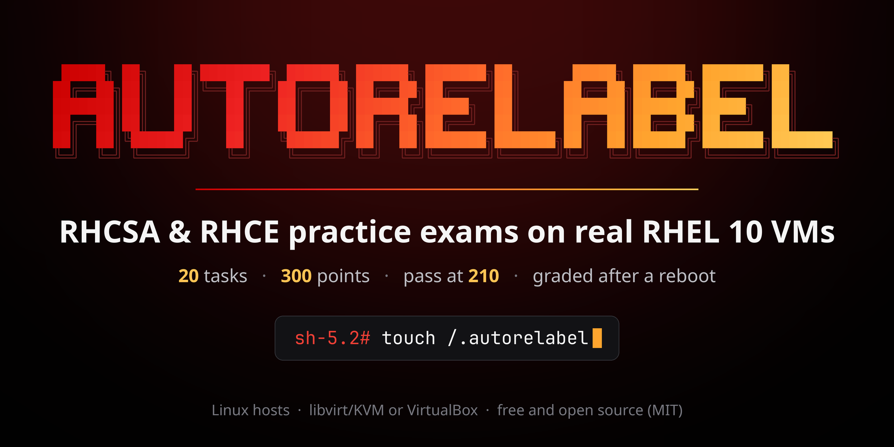

<div align="center">



# autorelabel: RHCSA & RHCE practice exam simulator for RHEL 10

**Timed, auto-graded, hands-on RHCSA (EX200) and RHCE (EX294) practice exams on real RHEL 10 virtual machines, graded *after a reboot*, just like the real thing.**

`touch /.autorelabel`: forget it after `rd.break` and your node won't let you log in. You'll never forget again.

</div>

https://github.com/user-attachments/assets/14ee6511-12b0-4dd1-a072-51f685ff5ea6

---

## What it is

autorelabel builds a small RHEL 10 lab on your Linux computer and turns it into an exam room. You get a 20-task RHCSA exam (180 minutes) or RHCE exam (240 minutes), worth 300 points with 210 needed to pass. When the time is up, or when you submit, every node is rebooted, and only then is your work graded. That is how Red Hat's performance-based exams work: anything that doesn't survive a reboot doesn't count, and your results point out exactly which checks passed before the reboot but failed after it.

- **Real RHEL 10.** The lab is built once from your own RHEL 10 DVD ISO, which you can download with a free Red Hat Developer account. No subscription is used, and the lab runs offline, like the exam.
- **Starts the way the real exam does.** One node has no network yet, so you configure it from its console. The other node's root password is unknown, so you interrupt its boot and reset it. An RHCE exam starts from an empty Ansible project directory.
- **157 tasks, every objective covered.** 102 RHCSA and 55 RHCE tasks practise every objective line on Red Hat's current exam pages, each line with at least two tasks.
- **Every task tested on real VMs.** Before a task ships, its reference solution, its accepted alternatives and its classic mistakes (`chcon` in place of `semanage fcontext`, a firewall rule without `--permanent`, a vault file left unencrypted) are all run on RHEL 10 and graded.
- **One command, one terminal app.** A text interface takes you through setup, the exam, node power controls, the serial console and your results, with a solution and links to Red Hat's documentation for every task. Every action also exists as a command for scripting.
- **Leaves your computer clean.** Everything it creates is recorded as it goes, and one command removes all of it.

## Supported platforms

| Host | Status |
|---|---|
| **Linux x86_64** (Ubuntu/Debian, Fedora, RHEL/Alma/Rocky/CentOS Stream, Arch, openSUSE) | ✅ libvirt/KVM (recommended) or VirtualBox 7.2.2+ |
| Windows 10/11 | ❌ Not supported yet: planned for v2 (VirtualBox) |
| WSL2 | ❌ Not supported |
| macOS | ❌ Not supported |

## Requirements

**Hardware:** an x86-64-v3 CPU (Intel Haswell or AMD Excavator and newer, which RHEL 10 requires) with virtualization enabled in the BIOS/UEFI, **about 3 GB of free RAM** for RHCSA (about 5.5 GB for RHCE) and **about 30 GB of free disk** (40 GB for RHCE).

**Software:** install these before you clone the repository. autorelabel never runs `sudo` itself. On its first run it checks your computer again and prints the exact commands, with undo commands, for anything still missing.

| What | Why |
|---|---|
| `git`, Python 3.10+ with `venv`, the OpenSSH client | to clone and run autorelabel (its Python libraries go into a private `.venv/` folder) |
| Vagrant 2.3+ and Packer 1.10+ | Packer builds the RHEL 10 box from your ISO once; Vagrant runs the lab VMs |
| **libvirt** (recommended): QEMU/KVM, libvirt and the `vagrant-libvirt` plugin, with your user in the `libvirt` and `kvm` groups | the hypervisor |
| **or VirtualBox** 7.2.2+, with your user in the `vboxusers` group | the hypervisor, if you prefer VirtualBox |

The commands for libvirt on each distribution (log out and back in afterwards, so the new groups apply):

<details>
<summary><b>Ubuntu / Debian</b></summary>

```bash
sudo apt update
sudo apt install -y git python3-venv openssh-client wget gpg qemu-system-x86 qemu-utils libvirt-daemon-system libvirt-clients
# Vagrant and Packer, from HashiCorp's repository
wget -O - https://apt.releases.hashicorp.com/gpg | sudo gpg --dearmor -o /usr/share/keyrings/hashicorp-archive-keyring.gpg
echo "deb [arch=$(dpkg --print-architecture) signed-by=/usr/share/keyrings/hashicorp-archive-keyring.gpg] https://apt.releases.hashicorp.com $(grep -oP '(?<=UBUNTU_CODENAME=).*' /etc/os-release || lsb_release -cs) main" | sudo tee /etc/apt/sources.list.d/hashicorp.list
sudo apt update && sudo apt install -y vagrant packer
# the vagrant-libvirt plugin
sudo apt install -y libvirt-dev build-essential pkg-config ruby-dev libxml2-dev libxslt1-dev zlib1g-dev
vagrant plugin install vagrant-libvirt
sudo systemctl enable --now libvirtd
sudo usermod -aG libvirt,kvm $USER
```

</details>

<details>
<summary><b>Fedora</b></summary>

```bash
sudo dnf install -y git python3 openssh-clients wget @virtualization vagrant vagrant-libvirt
sudo systemctl enable --now virtqemud.socket virtnetworkd.socket virtstoraged.socket
# Packer, from HashiCorp's repository (Fedora's own Vagrant stays: its vagrant-libvirt is built for it)
wget -O- https://rpm.releases.hashicorp.com/fedora/hashicorp.repo | sudo tee /etc/yum.repos.d/hashicorp.repo
sudo sed -i '/^\[hashicorp\]/a excludepkgs=vagrant' /etc/yum.repos.d/hashicorp.repo
sudo dnf install -y packer
sudo usermod -aG libvirt,kvm $USER
```

</details>

<details>
<summary><b>RHEL / AlmaLinux / Rocky Linux / CentOS Stream</b></summary>

```bash
sudo dnf install -y git python3 openssh-clients dnf-plugins-core qemu-kvm libvirt virt-install
sudo systemctl enable --now virtqemud.socket virtnetworkd.socket virtstoraged.socket
# Vagrant and Packer, from HashiCorp's repository
sudo dnf config-manager --add-repo https://rpm.releases.hashicorp.com/RHEL/hashicorp.repo
sudo dnf install -y vagrant packer
# the vagrant-libvirt plugin (on RHEL itself, enable CodeReady Builder in place of crb:
#   sudo subscription-manager repos --enable codeready-builder-for-rhel-$(rpm -E %rhel)-x86_64-rpms)
sudo dnf config-manager --set-enabled crb
sudo dnf install -y gcc make pkgconf-pkg-config libvirt-devel ruby-devel libxml2-devel
vagrant plugin install vagrant-libvirt
sudo usermod -aG libvirt,kvm $USER
```

</details>

<details>
<summary><b>Arch Linux</b></summary>

Vagrant is no longer in Arch's official repositories: install it from the AUR (for example `yay -S vagrant`) or with [HashiCorp's Linux binary](https://developer.hashicorp.com/vagrant/install) first.

```bash
sudo pacman -S --needed git python openssh packer libvirt qemu-full dnsmasq iptables-nft gcc make pkg-config ruby
vagrant plugin install vagrant-libvirt
sudo systemctl enable --now libvirtd
sudo usermod -aG libvirt,kvm $USER
```

</details>

<details>
<summary><b>openSUSE</b></summary>

Packer isn't packaged: put [HashiCorp's Linux binary](https://developer.hashicorp.com/packer/install) in `/usr/local/bin` first.

```bash
sudo zypper install -y git python3 openssh-clients vagrant vagrant-libvirt libvirt qemu-kvm polkit
sudo systemctl enable --now libvirtd
sudo usermod -aG libvirt,kvm $USER
```

</details>

**VirtualBox in place of libvirt:** install `git`, Python, OpenSSH, Vagrant and Packer as above (skip the libvirt and `vagrant-libvirt` lines), then VirtualBox 7.2.2 or newer from [virtualbox.org](https://www.virtualbox.org/wiki/Linux_Downloads) (Arch: `sudo pacman -S --needed virtualbox virtualbox-host-modules-arch`; openSUSE: `sudo zypper install -y virtualbox`) and `sudo usermod -aG vboxusers $USER`. Never run VirtualBox VMs and KVM VMs at the same time: on some kernels that freezes the KVM guests. autorelabel checks this before it starts a lab.

The Ubuntu route is the one tested end to end. The others follow each project's official instructions, and the first run checks the result either way. The [installation guide](docs/guide/01-installing.md) explains every step in detail.

## Getting started

You also need the **Red Hat Enterprise Linux 10 Binary DVD** (x86_64, about 8 GB). Create a free [Red Hat Developer](https://developers.redhat.com/register) account, download it, and keep it anywhere: the setup finds it in the repository folder or in `~/Downloads`, or you can type its path. Then:

```bash
git clone https://github.com/syed-913/autorelabel-rhcsa-rhce.git
cd autorelabel-rhcsa-rhce
./autorelabel
```

The first run sets up a private Python environment, checks your computer, asks where your ISO is and where to keep the VM disks, and builds the RHEL 10 box once (about 10 to 15 minutes). After that, a new exam is ready in a few minutes: `./autorelabel rhcsa` or `./autorelabel rhce` takes you straight to one.

## Documentation

The **[user guide](docs/guide/README.md)** covers everything else, in detail:

1. [Installing](docs/guide/01-installing.md): the dependencies, the first run and the box build
2. [Your first exam](docs/guide/02-first-exam.md), step by step
3. [The exam screen](docs/guide/03-exam-screen.md): every key and node action
4. [The lab](docs/guide/04-the-lab.md): the VMs, networks, accounts and the utility server
5. [Grading and results](docs/guide/05-grading-and-results.md): the reboot, partial credit and persistence warnings
6. [Practice mode](docs/guide/06-practice.md)
7. [Command reference](docs/guide/07-commands.md): using autorelabel from the command line
8. [Settings](docs/guide/08-settings.md)
9. [Troubleshooting](docs/guide/09-troubleshooting.md) and problem reports
10. [Files and uninstalling](docs/guide/10-files-and-uninstall.md)
11. [FAQ](docs/guide/11-faq.md)
12. [Exam objectives covered](docs/guide/12-objectives.md)

For contributors: [ARCHITECTURE.md](docs/ARCHITECTURE.md) and [TASK-AUTHORING.md](docs/TASK-AUTHORING.md).

## How it compares

Several open projects help people practise for these exams. This table compares the ones that provide a lab or practice exams, based on each project's own README as of 26 October 2026. If something here is wrong or out of date, please [open an issue](https://github.com/syed-913/autorelabel-rhcsa-rhce/issues) and it will be corrected.

| Project | Exam | RHEL | Lab setup | Practice tasks | Checks your work | Graded after a reboot | Timed exam |
|---|---|---|---|---|---|---|---|
| **autorelabel** | RHCSA, RHCE | 10.0, from your ISO | Automatic (Packer and Vagrant; libvirt or VirtualBox) | 157, drawn into 20-task exams | Yes, and every task is self-tested | Yes, every node | Yes, enforced (180 or 240 min) |
| [jconwell3115/RHCSA_RHEL_10](https://github.com/jconwell3115/RHCSA_RHEL_10) | RHCSA | 10 | By hand, with `virt-install` and helper scripts (KVM) | 3 exams of 35 tasks | Yes, verify scripts | Not described | Time limits suggested |
| [tucker-st/rhcsa-ex200](https://github.com/tucker-st/rhcsa-ex200) | RHCSA | 10, or Rocky/Alma | One VM, built from a guide | 8 labs | Yes, read-only grading scripts | Not described | Planned |
| [rdbreak/rhcsa8env](https://github.com/rdbreak/rhcsa8env) | RHCSA | 8 | Automatic (Vagrant and Ansible; VirtualBox) | None included | Not described | Not described | Not described |
| [ive663/RHCSA](https://github.com/ive663/RHCSA) | RHCSA | 8 | Vagrant playground of 4 empty VMs | A collection of questions | Not described | Not described | Not described |
| [aggressiveHiker/rhcsa9](https://github.com/aggressiveHiker/rhcsa9) | RHCSA | 9 | By hand, from guidelines | A task list with solutions | Not described | Not described | No, a study list |
| [RedHatRanger/RHCE9Vagrant](https://github.com/RedHatRanger/RHCE9Vagrant) | RHCE | 9 | Automatic (Vagrant; VirtualBox, 6 VMs) | About 18 sample questions | Not described | Not described | Not described |
| [x69van/rhce9-ex294-practice-lab](https://github.com/x69van/rhce9-ex294-practice-lab) | RHCE | 9 | Pre-built disk image (KVM), cloned by hand | 18 tasks with solutions | A connectivity check | Not described | Not described |
| [victorbrca/rhce8-practice-env](https://github.com/victorbrca/rhce8-practice-env) | RHCE | 8.4 | Automatic (Vagrant and Ansible; VirtualBox, 6 VMs) | A few practice exams | Not described | Not described | Not described |

What sets autorelabel apart is the exam itself: a fresh 20-task exam each time, a clock that locks the lab at zero, grading after a reboot of every node, and tasks that were each verified on real RHEL 10 VMs. The others have strengths of their own. Several run on Windows today through VirtualBox (autorelabel adds Windows in v2), and several come with study notes, which autorelabel doesn't try to replace.

## License

autorelabel is released under the [MIT License](LICENSE).

> **autorelabel is not affiliated with, endorsed by or sponsored by Red Hat, Inc. in any way, and it does not contain, or claim to contain, real exam tasks.** Every task was written from the objectives published on Red Hat's [EX200](https://www.redhat.com/en/services/training/ex200-red-hat-certified-system-administrator-rhcsa-exam) and [EX294](https://www.redhat.com/en/services/training/ex294-red-hat-certified-engineer-rhce-exam-red-hat-enterprise-linux) exam pages, as mapped in [COVERAGE-RHCSA.md](docs/COVERAGE-RHCSA.md) and [COVERAGE-RHCE.md](docs/COVERAGE-RHCE.md), and from Red Hat's public documentation. Red Hat, RHEL, RHCSA and RHCE are trademarks of Red Hat, Inc.
